# 🛠️ ServiceDesk — IT Service Management System

  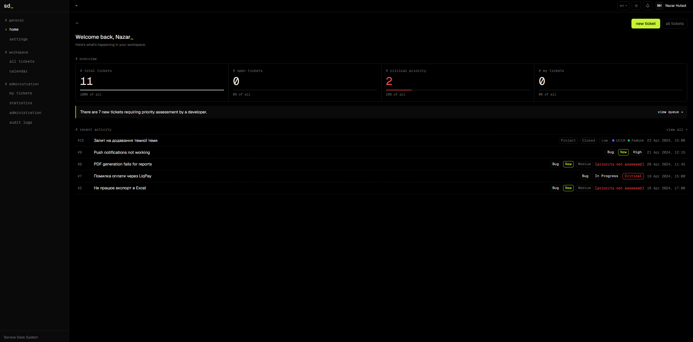

  
  
  
  
  
  

---

## 📌 Overview

**ServiceDesk** is a modern, responsive IT Service Management (ITSM) system built with **.NET 10** and **Blazor Server**. It simplifies incident tracking, SLA management, and team collaboration with native multilingual support (🇬🇧 English / 🇺🇦 Ukrainian / 🇩🇪 German / 🇪🇸 Spanish / 🇫🇷 French) and role-based access control (RBAC).

Since **v2.0** the UI follows an "ops terminal" design: Geist and Geist Mono, design tokens instead of ad-hoc colours, `~/path` headings, single-hue charts, one accent colour (lime, amber, phosphor or ice) in a light or dark theme, and a `Ctrl+K` command palette that works like a small shell (`cd ~/tickets`, `theme light`, `accent amber`, `lang uk`) with live preview.

> 💻 **Setup Note:** Uses a local MySQL database. Connection settings are in `appsettings.Development.json`. For Docker deployment, use environment variables.
>
> 🎨 **Styles:** Requires **Node.js 22+**. `dotnet build` compiles Tailwind; use `-p:SkipTailwindBuild=true` to skip.

---

## 🏗️ Architecture

The project is built on **Clean Architecture** principles, separating concerns into four independent layers. The **Domain** layer defines the core entities (Ticket, User, Product, etc.) and interfaces with no external dependencies. The **Application** layer orchestrates business logic and use cases on top of those interfaces. The **Infrastructure** layer provides concrete implementations — EF Core persistence, MySQL, SMTP email, and migrations. Finally, two presentation entry points sit at the top: a **Blazor Server** app for the interactive UI (over SignalR) and a **REST API** for third-party integrations.

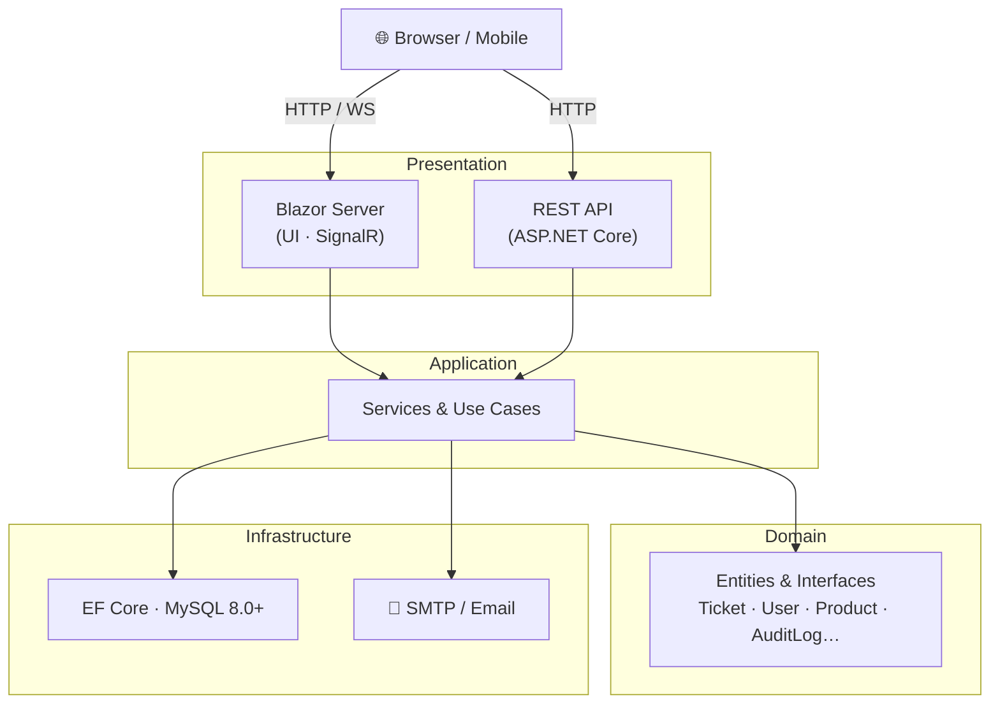

---

## 📸 Screenshots

### 🔑 Authentication

| Dark Mode | Light Mode |
| :---: | :---: |
| 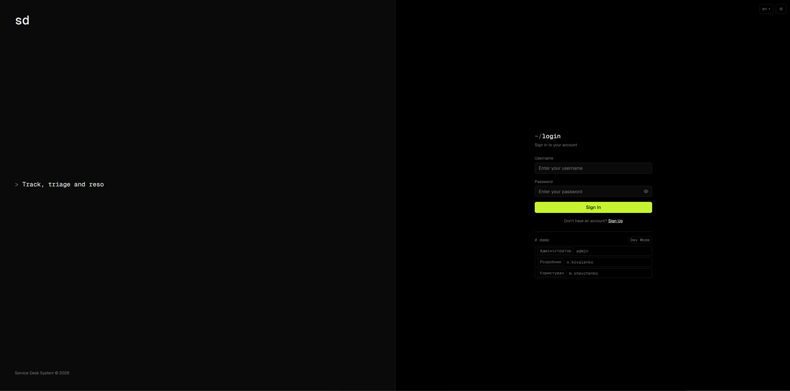 | 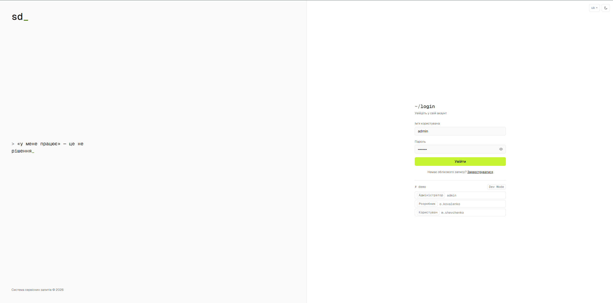 |

### 📊 Home & Analytics

| Home | Statistics |
| :---: | :---: |
|  | 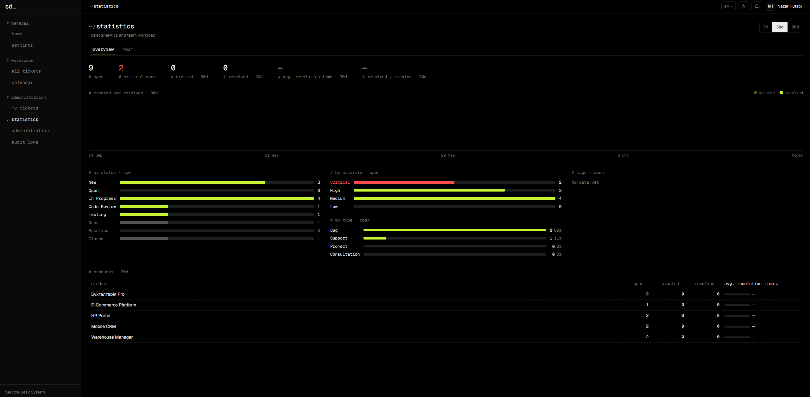 |

### 🎫 Ticket Management

| Kanban Board | Developer Queue |
| :---: | :---: |
| 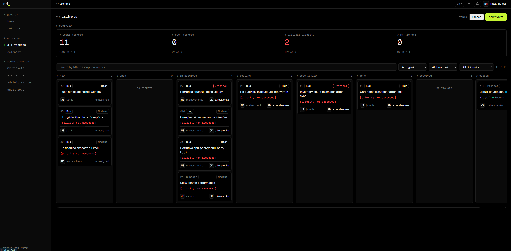 | 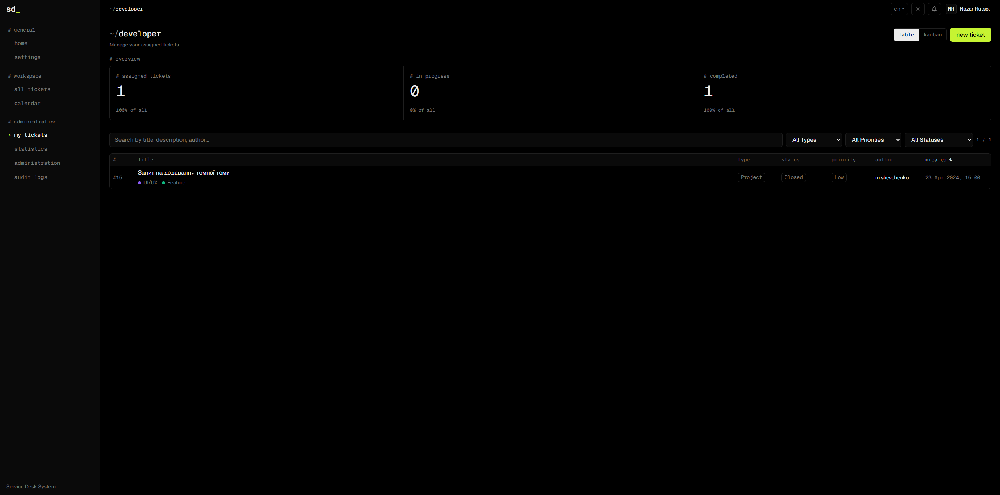 |

| Calendar | Profile & Activity |
| :---: | :---: |
| 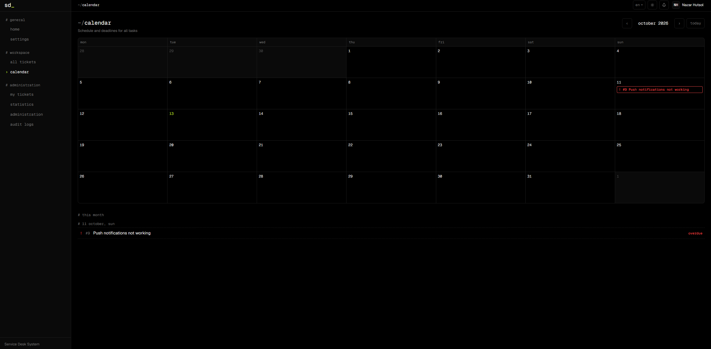 | 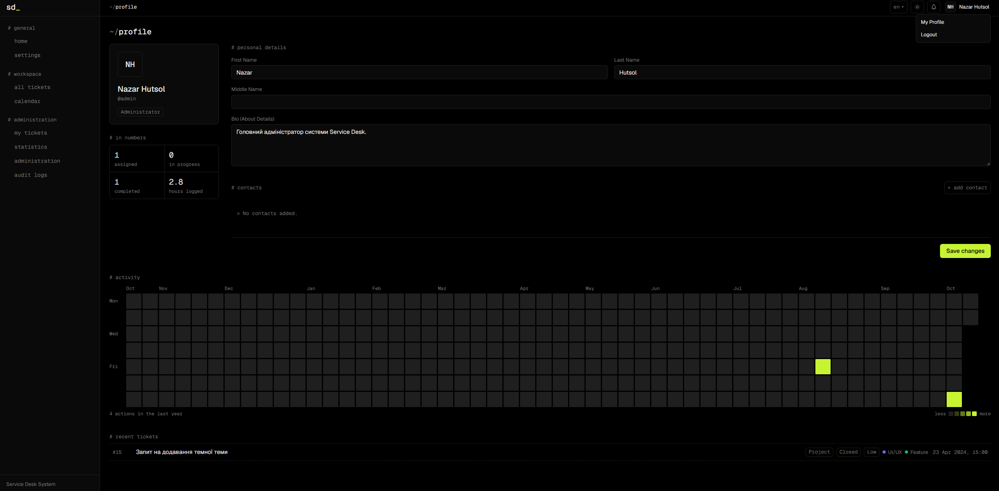 |

### ⚙️ Admin Panel & Audit Logs

| Administration | Audit Log Stream |
| :---: | :---: |
| 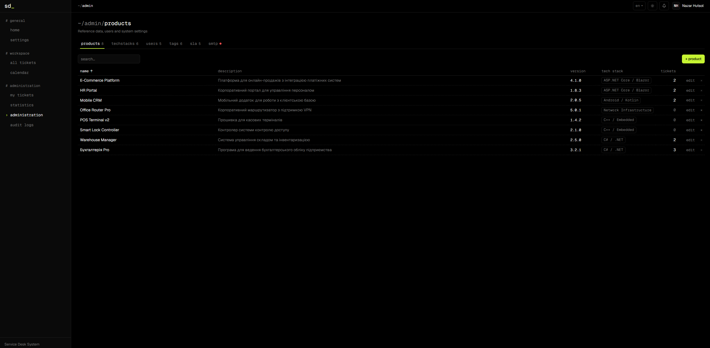 | 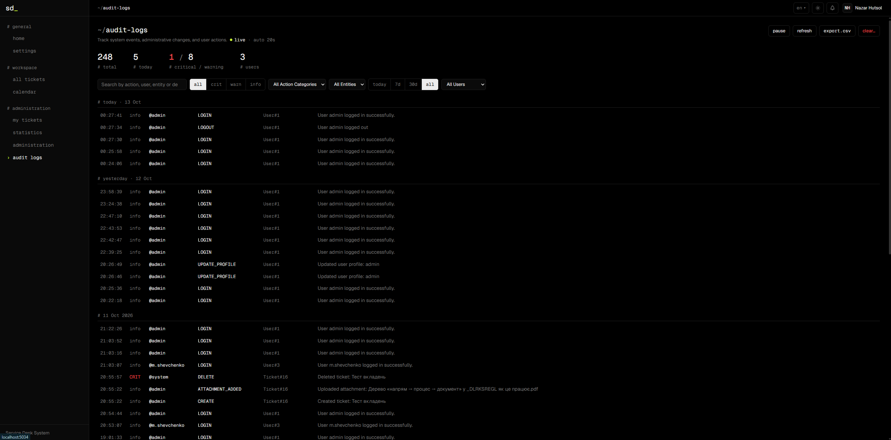 |

---

## ✅ Features

| Feature | Status |
|---|:---:|
| Multilingual UI (EN / UA / DE / ES / FR) | ✅ |
| Terminal-style design system (light / dark, 4 accents) | ✅ |
| Command palette with live theme & accent preview | ✅ |
| Statistics from real status history (period, time zone aware) | ✅ |
| Interactive Dashboard (MTTR, MTBF, SLA) | ✅ |
| Role-Based Access Control (RBAC) | ✅ |
| Email Notifications (SMTP) | ✅ |
| Mobile-Responsive Web App | ✅ |
| RESTful API | ✅ |
| Audit Logging | ✅ |
| Advanced SLA Policies & Escalations | ✅ |
| Knowledge Base & Self-Service | 🔜 |
| Advanced Reporting & Export | 🔜 |

---

## ⚙️ Tech Stack

| Layer | Technology |
|---|---|
| Frontend | Blazor Server + Tailwind CSS |
| Backend | ASP.NET Core (.NET 10) |
| Database | MySQL 8.0+ via Entity Framework Core |
| Containerization | Docker |

---

## 📄 License

Licensed under the [MIT License](LICENSE). Contributions, issues, and feature requests are welcome!
